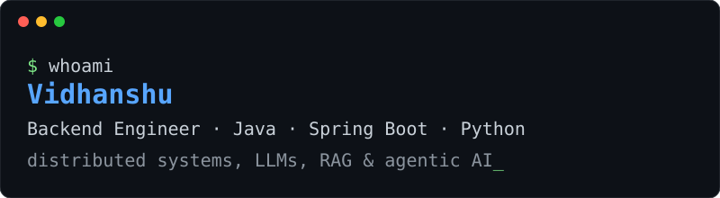

  

Hi, I'm **Vidhanshu**, a backend-focused software engineer who works mostly with **Java and Spring Boot**.
I'm finishing my M.Sc. IT at Somaiya Vidyavihar University and I'm looking for **fresher software engineering roles**.

I like understanding how systems work underneath, so I build things like a message queue from scratch instead of only using one.

## About Me

- Backend developer: Java, Spring Boot, SQL, REST APIs
- Built a distributed message queue with a custom TCP protocol, replication and leader election
- Built a GitHub bot that reviews pull requests using an LLM and RAG
- Working with AI: LLMs, RAG, agentic AI, LangChain and LangGraph in Python
- Completed an internship at Anantkaal LLP
- Learning React and TypeScript to be more comfortable on the frontend

## Projects

### [QueueForge](https://github.com/vidhanshu37/QueueForge): distributed message queue
Kafka-inspired message queue written in Java and Spring Boot, built from scratch.
- Custom length-prefixed TCP protocol between brokers and clients
- Partitions with consistent-hash routing (virtual nodes)
- File-based log with segment rolling, retention and a sparse offset index
- Leader-follower replication with ISR tracking and producer acks (0 / 1 / all)
- Raft-based leader election and consumer groups

### [PR Reviewer](https://github.com/vidhanshu37/REPLACE-WITH-REPO-NAME): AI pull request reviewer
Spring Boot backend that reviews GitHub pull requests automatically.
- GitHub App webhook triggers a review on each PR
- RAG with Postgres and pgvector, LLM through Groq, Redis for caching
- React + TypeScript dashboard to browse repos, PRs and reviews

### [Patient Management System](https://github.com/vidhanshu37/REPLACE-WITH-REPO-NAME): microservices
Patient management backend split into independent microservices.

## Tech Stack

**Backend:** Java, Spring Boot, REST APIs, SQL, Redis

**AI / LLM:** Python, LangChain, LangGraph, LLMs, RAG, Agentic AI

## Achievements

- LeetCode max rating **1815** (top 8%)
- **2nd rank** in a hackathon during my BCA

## Contact

